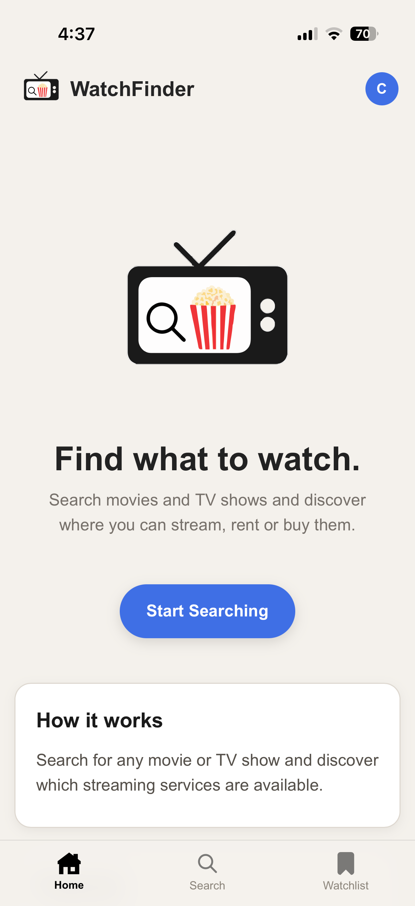
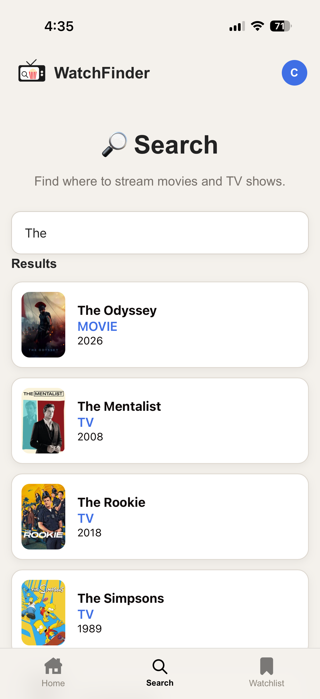
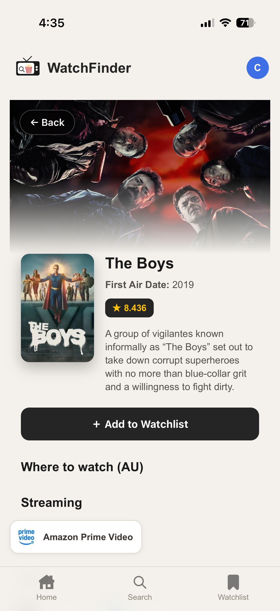
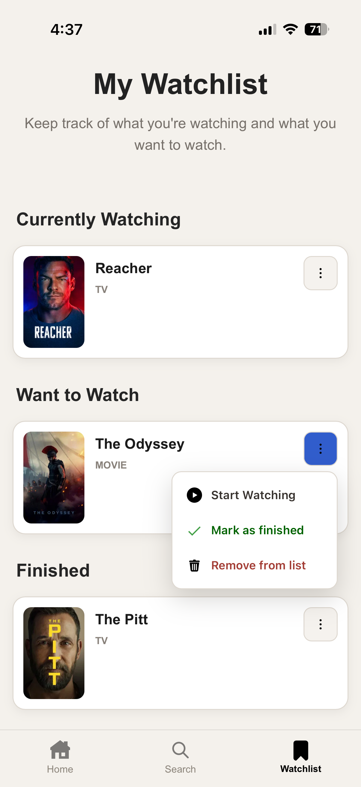
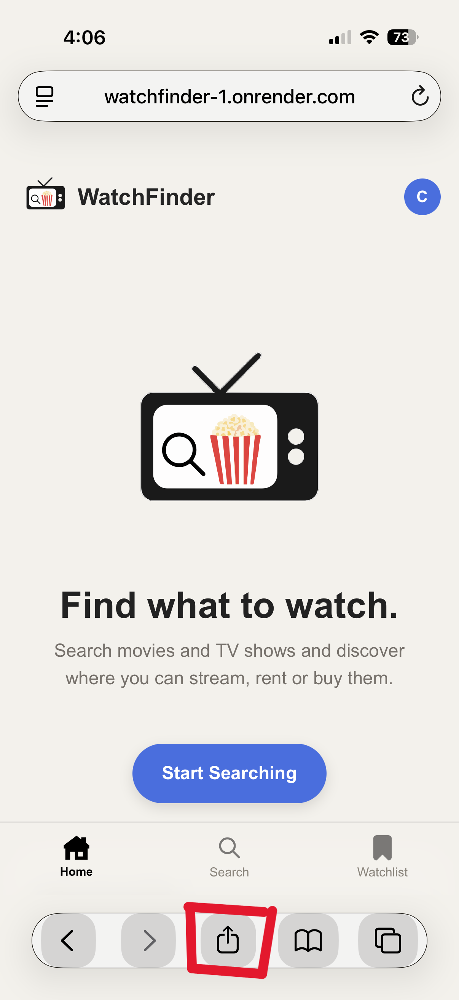
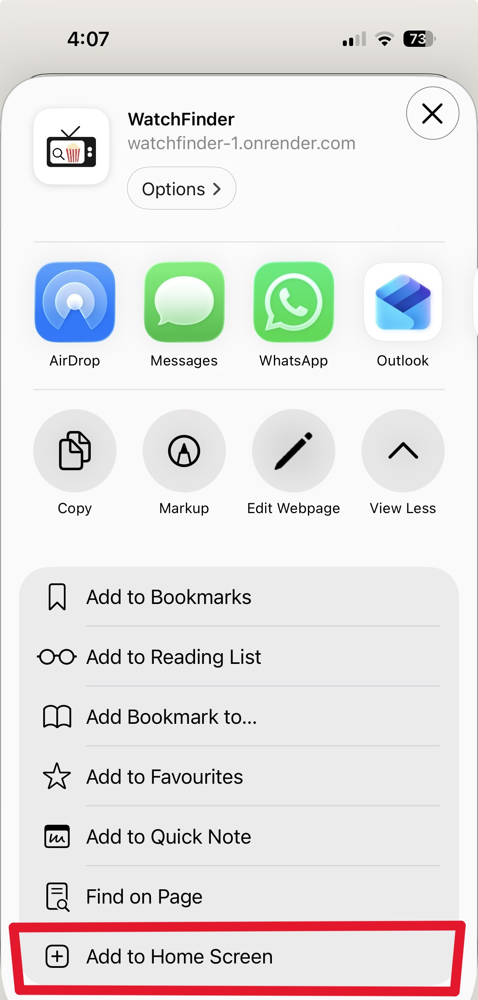
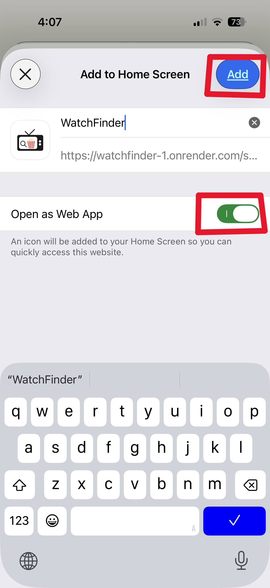

# WatchFinder

WatchFinder is a mobile-first movie and TV discovery app that helps users find titles and see where they are available to watch.

Users can search for movies and TV shows, view streaming providers, create an account, and organise titles in a personal watchlist.

## Live Version

### Visit WatchFinder: 
https://watchfinder-1.onrender.com/

## Features

<p>
  
  
  
  
</p>

- Search for movies and TV shows
- Autocomplete search suggestions
- View movie and TV show details
- View available streaming providers
- Create an account and log in
- Password reset via email
- Personal watchlist
- Organise watchlist items into:
  - Currently Watching
  - Want to Watch
  - Finished
- Responsive mobile-first design

## Add WatchFinder to your Apple phone

WatchFinder is designed with a mobile-first interface and can be added to your phone's home screen for quick access.

1. Open the WatchFinder URL on your phone:
   https://watchfinder-1.onrender.com/
2. Open your browser's options/share menu.
3. Select **Add to Home Screen** or the equivalent option.
4. WatchFinder will then be available from your phone's home screen.
<p>
  
  
  
</p>

## Why I Built This

I created WatchFinder as a personal software project to develop my skills in:

- Python and FastAPI
- API integration
- Databases and user authentication
- HTML, CSS and JavaScript
- Responsive and mobile-first web design
- Git and GitHub
- Deploying and hosting a web application
- Application health monitoring
- Email and Password validate and administration intergration
## Tech Stack

- **Python**
- **FastAPI**
- **SQLAlchemy**
- **Supabase (PostgreSQL database)**
- **Resend (password reset system)**
- **HTML / Jinja2**
- **CSS**
- **JavaScript**
- **HTMX**
- **TMDB API**
- **Git / GitHub**
- **Render**
## Deployment
WatchFinder is hosted on **Render**, with **Supabase** used for the application's PostgreSQL database.

Resend is used for password reset.

The application includes a /health endpoint that checks whether the FastAPI application is responding successfully. An automated scheduled health check requests this endpoint to monitor the deployed service and help prevent/monitor the Render service from remaining inactive.

A separate /db-health endpoint is also available to check connectivity to the PostgreSQL database.
## Run Locally

### Requirements

To run WatchFinder locally, you will need:

- Python 3.10+
- Git
- A TMDB API key
- A Supabase PostgreSQL database
- Resend account and API key

### 1. Clone the repository
```bash
git clone https://github.com/Croppy21/watchfinder.git
cd watchfinder
```
### 2. Create a virtual environment

Windows:
```bash
python -m venv venv
```
Activate it:
```bash
venv\Scripts\activate
```
Mac/Linux:
```bash
python3 -m venv venv
```
Activate it:
```bash
source venv/bin/activate
```
### 3. Install dependencies
```bash
pip install -r requirements.txt
```
### 4. Create a .env file

Create a .env file in the root of the project and add the required configuration.

The database connection details can be obtained from your Supabase project.

TMDB_READ_ACCESS_TOKEN=your_api_key_here  
DATABASE_USER=your_database_user  
DATABASE_PASSWORD=your_database_password  
DATABASE_HOST=your_database_host  
DATABASE_PORT=your_database_port  
DATABASE_NAME=your_database_name  
SESSION_SECRET_KEY=your_secret_key_here  
RESEND_API_KEY=re_your_actual_key_here
APP_BASE_URL=http://127.0.0.1:8000

Generate a long, random value for SESSION_SECRET_KEY.

Do not commit your .env file to GitHub.

### 5. Run the application

Start the FastAPI development server:
```bash
uvicorn app:app --host 0.0.0.0 --reload
```  
Open WatchFinder on your computer:

http://127.0.0.1:8000  

View on a Mobile Device

WatchFinder is designed with a mobile-first interface, so it can also be tested on a phone while running locally.

### 1. Connect to the same Wi-Fi

Make sure your phone and computer are connected to the same Wi-Fi network.

### 2. Find your computer's local IP address

Windows:
```bash
ipconfig
```
Look for the IPv4 Address.

Mac/Linux:
```bash
ifconfig
```
or:
```bash
ip addr
```
### 3. Start the server

Make sure the server is running with:
```bash
uvicorn app:app --host 0.0.0.0 --reload
```
### 4. Open WatchFinder on your phone

Enter your computer's local IP address followed by port 8000:

http://YOUR_LOCAL_IP:8000

For example:

http://192.168.1.25:8000

Your phone and computer must remain connected to the same network while testing locally.

# Disclaimer

WatchFinder uses the TMDB API to access TMDB's database for movie and TV show information.

This project is not affiliated with or endorsed by TMDB.

WatchFinder is a personal project created for learning, development and portfolio purposes. No money has been made from this project, and it is not intended to be a commercial product.

Movie and TV data is provided by TMDB.

User account and watchlist data is stored in a Supabase PostgreSQL database.

# Project Status

WatchFinder is a completed personal software development project.

The current version represents the final planned feature set. Minor UI fixes, maintenance and refinements may still be made, but no additional major features are currently planned.

Built as a personal software development project.